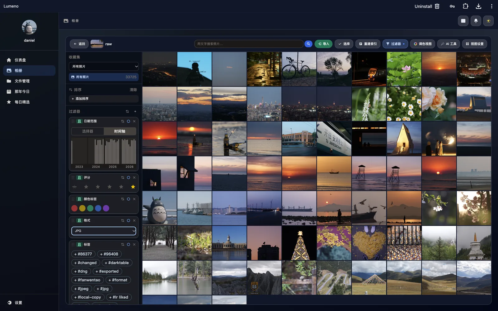
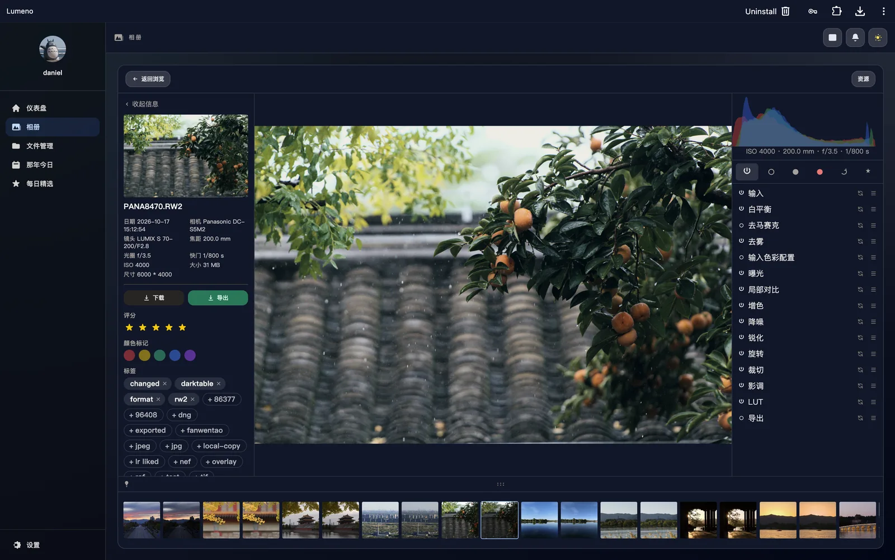
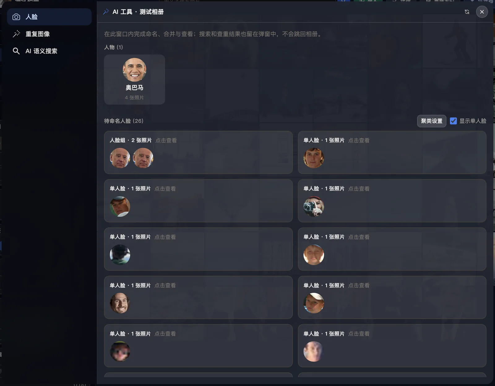

# Lumeno

[](LICENSE)


**A self-hosted photo and file library that keeps the originals on your disk.**

[简体中文](README.zh-CN.md) · [Screenshots](#screenshots) · [Quick start](#quick-start) · [Configuration](#configuration) · [License](#license)



Lumeno is a self-hosted personal photo and file library. The backend is Rust/Axum, the frontend is Vue 3, and storage is the filesystem. It is built around two rules:

- **Originals and XMP are the source of truth.** They live in your own directory and are never rewritten by the index.
- **Indexes, thumbnails, transcodes, and face embeddings are disposable.** They can be deleted and rebuilt.

The same library has a desktop shell and a mobile web shell, backed by the same API.

> **Project status: early (0.1.x).** Back up `dist/data/` before upgrading. On-disk layout and APIs may still change between releases.

## Features

- Browse, upload, download, copy, move, rename, and delete files and folders.
- Resumable chunked uploads with background task progress.
- Albums with covers, imports/exports, read-only shares, and per-album permissions.
- JPEG, PNG, GIF, BMP, WebP, TIFF, HEIC/AVIF (via `libheif`), and RAW (via LibRaw or `darktable-cli`).
- EXIF capture details; tags, ratings, and color labels written to XMP sidecars.
- Filter by date, camera, lens, tag, rating, color label, and format; timeline and virtual scrolling.
- “On this day” and daily picks.
- MP4/M4V/MOV/WebM import, cover extraction, playback, and cached transcoding with `ffmpeg`.
- Non-destructive grade documents (`.lumeno.json` next to the original) with a desktop tune workspace and a mobile editor.
- Multi-user administration, album roles, WebDAV shares, storage reports, and cache cleanup.
- English and Chinese UI, light and dark themes.
- Optional AI: text search, similar-photo search, face detection/embedding and clustering. Local models are opt-in; a remote provider is also supported.

## Current limitations

| Area | Status |
| --- | --- |
| Public/anonymous sharing | Not yet. Share to existing accounts or use WebDAV. |
| Automatic backup / background import | Not yet. |
| Live Photos / Motion Photo | Not yet. |
| GPS and map view | Not yet. |
| Object tags and semantic object search | Not yet. |
| Burst stacking | Not yet. |
| Archive/favorites library | Partial: ratings and color labels only. |
| Duplicate prevention on import | Partial: similar-photo search exists; import does not skip duplicates automatically. |
| Offline mode | Not yet. |
| Native mobile app | Not yet; the mobile shell is a responsive web/PWA surface. |
| Windows | Not supported; LibRaw through `rsraw-sys` does not support MSVC. |

## Screenshots

### Library

Filters, tags, ratings, timeline, and a virtualized photo grid.


### Photo detail and tune workspace

Capture details, XMP metadata, filmstrip, histogram, and the non-destructive grade stack.



### AI tools

Face clusters, person naming, and similarity search. Local face models are optional and subject to the non-commercial InsightFace terms; a remote provider is also supported.



## Platform support

| Platform | Builds | Notes |
| --- | --- | --- |
| Linux x86_64 | Yes | `.cargo/config.toml` targets `x86-64-v3` (AVX2/FMA); change it for older NAS CPUs. |
| Linux arm64 | Yes | Requires an ARMv8.2+ CPU with FP16; `gemm-f16` needs it. Older ARMv8.0 devices (e.g. Cortex-A53) cannot build it. |
| macOS arm64 | Yes | Local AI uses Metal; no Vulkan SDK needed. |
| macOS x86_64 | Untested | Source build may work. |
| Windows | No | `rsraw-sys` does not support MSVC. |
| Docker | Not yet | No published image or production Dockerfile; run from source for now. |

Optional external tools:

| Tool | Enables | Required? |
| --- | --- | --- |
| `darktable-cli` | RAW thumbnails, previews, and exports | Optional |
| `exiftool` | RAW/video capture details | Optional |
| `ffmpeg`, `ffprobe` | Video covers, transcoding, source probing | Optional |

## Quick start

Requirements: Rust nightly, Node.js 20+, a C/C++ toolchain, `pkg-config`, `libheif >= 1.17`, and `libclang`.

```bash
rustup toolchain install nightly

cd frontend
npm ci
npm run build
cd ..

export BOOTSTRAP_ADMIN_USER=admin
export BOOTSTRAP_ADMIN_PASSWORD='replace-with-a-strong-password'
cargo +nightly run
```

Open `http://localhost:3000`.

If `BOOTSTRAP_ADMIN_PASSWORD` is unset, Lumeno generates a random administrator password and prints it once to stderr. `BOOTSTRAP_ADMIN_USER` defaults to `admin`.

The process reads `./dist/data` and `./dist/resources` relative to the working directory, so run it from the repository root (or set the service `WorkingDirectory` accordingly). It creates `dist/data` on first start if it is missing; `dist/resources` still needs the frontend build.

## Installation

### System dependencies

- Rust nightly. The code uses `#![feature(normalize_lexically)]`; stable Rust will not compile it.
- Node.js 20+ and npm.
- A C/C++ toolchain (`cc`, `c++`). LibRaw is compiled by `cc` at build time.
- `pkg-config` for `libheif-sys`.
- `libheif` development headers, version **>= 1.17**. The crate enables `libheif-rs/v1_17` and does not use `embedded-libheif`, so a system library is required.
- `libclang` for `rsraw-sys`/`bindgen`. Set `LIBCLANG_PATH` if it is not found automatically.

**macOS**

```bash
xcode-select --install
brew install pkgconf libheif

# If bindgen cannot find libclang:
# brew install llvm
# export LIBCLANG_PATH="$(brew --prefix llvm)/lib"
```

**Debian / Ubuntu**

```bash
sudo apt install build-essential pkg-config libheif-dev libclang-dev
```

Debian 12 (bookworm) ships libheif 1.15, which is too old. Use Debian 13 (trixie), Ubuntu 24.04+, enable bookworm-backports (1.19), or build libheif 1.17+ yourself.

Check the version:

```bash
pkg-config --modversion libheif   # must be >= 1.17
c++ --version
```

Platform notes:

- macOS local AI uses Metal and does **not** need the Vulkan SDK. Linux uses Vulkan.
- ARM64 Linux needs ARMv8.2+ FP16 for `gemm-f16`; see the platform table above.
- Windows MSVC is not supported.

### Build and run

```bash
cd frontend
npm ci
npm run build
cd ..

cargo +nightly build --release
./target/release/lumeno
```

The frontend build writes `dist/resources/`, which Axum serves directly. `dist/data/` is the persistent root for users, sessions, settings, the HMAC key, originals, and XMP sidecars.

### Run as a service

Example systemd unit (adjust paths and user):

```ini
[Unit]
Description=Lumeno
After=network.target

[Service]
Type=simple
User=lumeno
Group=lumeno
WorkingDirectory=/opt/lumeno
Environment=LISTEN_ADDR=127.0.0.1:3000
# Enable only behind a trusted reverse proxy:
# Environment=TRUST_PROXY=1
ExecStart=/opt/lumeno/target/release/lumeno
Restart=on-failure
RestartSec=5

[Install]
WantedBy=multi-user.target
```

Keep `BOOTSTRAP_ADMIN_PASSWORD` in an `EnvironmentFile` with restrictive permissions rather than a world-readable unit file. The service user must own `dist/data/`; do not run Lumeno as root.

## Upgrade

```bash
sudo systemctl stop lumeno

# 1. Back up first. This is the only copy of the originals and XMP.
tar -C /opt/lumeno -czf "lumeno-data-$(date +%F).tar.gz" dist/data

# 2. Update code and rebuild.
git pull --ff-only
cd frontend && npm ci && npm run build && cd ..
cargo +nightly build --release

sudo systemctl start lumeno
```

Read release notes before upgrading if a release mentions a data migration. Keep the backup until you have verified the new version; downgrading after a migration may require restoring it.

## Backup and restore

Back up the whole `dist/data/` tree:

```bash
sudo systemctl stop lumeno
tar -C /opt/lumeno -czf "lumeno-data-$(date +%F).tar.gz" dist/data
sudo systemctl start lumeno
```

This includes users, sessions, settings, `hmac_key.bin`, uploaded originals, albums, and XMP sidecars. Caches, thumbnails, transcodes, and AI indexes can be rebuilt and do not need to be in the backup.

To restore, stop the service, move the current `dist/data/` aside, extract the archive into the same path, restore ownership, and start the service. Keep the original `hmac_key.bin`: losing it invalidates every existing login session.

## Reverse proxy

Run Lumeno behind HTTPS and keep port 3000 bound to localhost.

Nginx example:

```nginx
server {
    listen 443 ssl;
    http2 on;
    server_name photos.example.com;

    ssl_certificate     /etc/ssl/fullchain.pem;
    ssl_certificate_key /etc/ssl/privkey.pem;

    # Lumeno accepts large uploads and streams downloads.
    client_max_body_size 0;
    proxy_read_timeout 3600s;
    proxy_send_timeout 3600s;

    location / {
        proxy_pass http://127.0.0.1:3000;
        proxy_http_version 1.1;
        proxy_set_header Host $host;
        proxy_set_header X-Forwarded-Proto $scheme;
        proxy_set_header X-Forwarded-For $proxy_add_x_forwarded_for;
        proxy_request_buffering off;
    }
}
```

Caddy example:

```caddyfile
photos.example.com {
    reverse_proxy 127.0.0.1:3000
}
```

Set `TRUST_PROXY=1` **only** when the proxy overwrites `X-Forwarded-Proto`; otherwise a client could spoof it. WebDAV is served at `/dav/` on the same host and uses the same session/HTTPS policy.

## Configuration

| Variable | Description | Default |
| --- | --- | --- |
| `LISTEN_ADDR` | HTTP listen address passed to `TcpListener::bind` | `[::]:3000` |
| `BOOTSTRAP_ADMIN_USER` | Administrator username created on first start | `admin` |
| `BOOTSTRAP_ADMIN_PASSWORD` | Administrator password on first start | Random password printed once |
| `TRUST_PROXY` | Trust the proxy’s `X-Forwarded-Proto` for HTTPS cookie decisions | Off |
| `LUMENO_AI_DEVICE` | Local AI device: `auto`, `cpu`, `gpu`, `cuda`, `metal`, or `vulkan` | `auto` |
| `AI_REMOTE_TOKEN` | Bearer token for the remote AI provider; read only from the environment | Unset |

`TRUST_PROXY` must stay off unless the reverse proxy is the only path to the service.

## AI models and licensing

Lumeno works without AI. Local AI is an optional model pack:

- SigLIP 2 is Apache-2.0.
- InsightFace SCRFD/ArcFace pretrained weights are **non-commercial research only**.
- The repository, container images, and releases do not bundle `dist/models/`.
- `scripts/convert_ai_models.py --download` refuses to run without `--accept-insightface-noncommercial`.
- For commercial deployments, use the remote AI provider (`ai_provider=remote`) or obtain a separate license for the face models.

See [docs/ai-models.md](docs/ai-models.md), [docs/ai-provider-api.md](docs/ai-provider-api.md), and [THIRD_PARTY_LICENSES.md](THIRD_PARTY_LICENSES.md).

## Development

```bash
cd frontend
npm ci
npm run build
cd ..

cargo +nightly test
```

The frontend is served by Axum from `dist/resources/`. The desktop shell lives in `frontend/src/App.vue` and its components; the mobile shell lives in `frontend/src/mobile/`. Both talk to the same backend.

Architecture and behavior notes:

- [docs/color-pipeline.md](docs/color-pipeline.md) — grade pipeline semantics.
- [docs/tune-view.md](docs/tune-view.md) — desktop tune workspace.
- [docs/mobile-tune-view.md](docs/mobile-tune-view.md) — mobile editor.
- [docs/ai-models.md](docs/ai-models.md) — model pipeline and licensing.
- [AGENTS.md](AGENTS.md) — repository conventions and security rules.

## Project layout

```text
src/backend/        auth, files, albums, settings, tasks, AI, WebDAV HTTP
src/grade/          non-destructive grade documents, buffers, execution
frontend/src/       desktop Vue UI and shared composables
frontend/src/mobile/ mobile shell, routing, screens
frontend/public/    PWA manifest, service worker, icons
locales/            backend i18n (rust-i18n)
docs/               architecture and operations notes
docs/screenshots/   README screenshots
scripts/            model conversion and test-data helpers
dist/data/          runtime data (ignored by git)
dist/resources/     frontend build output (ignored by git)
```

## Security

- Serve Lumeno over HTTPS. The session cookie is `HttpOnly`, `SameSite=Strict`, and only marked `Secure` on a verified HTTPS connection.
- Keep `dist/data/` readable only by the service user. It contains sessions, password hashes, the HMAC key, and private photos.
- Share albums through album permissions or WebDAV; do not expose the whole library to another account.
- Never commit `.env` files, `dist/data/`, or model weights. Use a secret manager or a protected `EnvironmentFile`.
- Report security issues privately once the repository is public; do not open a public issue with exploit details.

## Contributing

Issues and pull requests are welcome. Keep changes focused, include a test or a reproducible check for behavior changes, and run the frontend build plus `cargo +nightly test` before opening a pull request.

## License

Lumeno is released under the **GNU Affero General Public License v3.0 or later**. See [LICENSE](LICENSE).

Third-party components and model licenses are listed in [THIRD_PARTY_LICENSES.md](THIRD_PARTY_LICENSES.md). In particular, the repository does not bundle InsightFace pretrained weights.

## Acknowledgements

Rust, Tokio, Axum, Vue, Vite, Tailwind CSS, Virtua, Burn, LibRaw, libheif, darktable, ExifTool, and FFmpeg. Optional external tools are separate programs with their own licenses.
