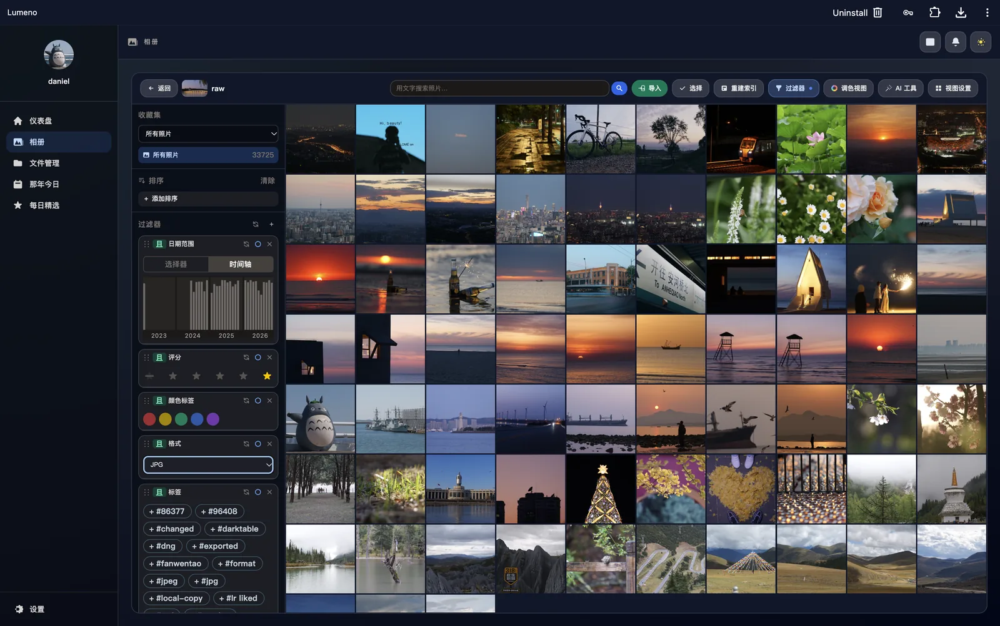
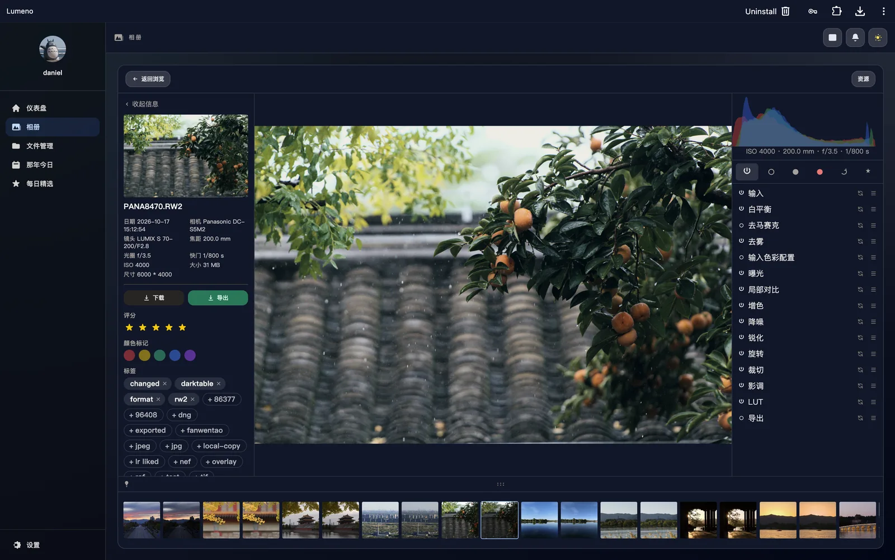
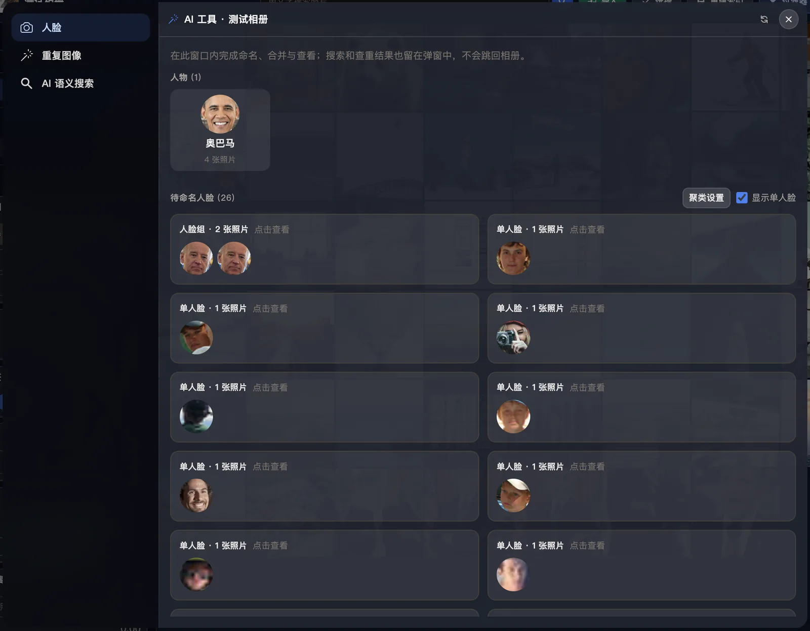

# Lumeno

[](LICENSE)


**把原片留在自己磁盘上的自托管照片与文件库。**

[English](README.md) · [截图](#截图) · [快速开始](#快速开始) · [配置](#配置) · [许可证](#许可证)



Lumeno 是一个自托管的个人照片与文件库。后端使用 Rust/Axum，前端使用 Vue 3，存储直接使用文件系统。它只守两条规则：

- **原片和 XMP 是唯一事实来源。** 它们在你自己的目录里，索引不会改写它们。
- **索引、缩略图、转码缓存和人脸嵌入都可以丢弃。** 删掉之后可以重建。

同一套图库有桌面壳和手机 Web 壳，共用同一个后端 API。

> **项目状态：早期（0.1.x）。** 升级前请备份 `dist/data/`。磁盘布局和 API 在正式版前仍可能变化。

## 功能

- 浏览、上传、下载、复制、移动、重命名和删除文件与目录。
- 断点分块上传，后台任务显示进度。
- 相册封面、导入导出、只读分享和按相册授权。
- JPEG、PNG、GIF、BMP、WebP、TIFF、HEIC/AVIF（经 `libheif`）和 RAW（LibRaw 或 `darktable-cli`）。
- 读取 EXIF；标签、评分、色标写入 XMP sidecar。
- 按日期、相机、镜头、标签、评分、色标和格式筛选；时间轴与虚拟滚动。
- “那年今日”和每日精选。
- MP4/M4V/MOV/WebM 导入、封面、播放，以及用 `ffmpeg` 转码并缓存。
- 非破坏调色：原片旁的 `.lumeno.json`，桌面调色工作区与手机编辑器。
- 多用户管理、相册角色、WebDAV 共享、存储统计和缓存清理。
- 中英文界面，明暗主题。
- 可选 AI：文字搜索、相似照片、人脸检测/嵌入与聚类。本地模型需要显式安装，也支持远程 provider。

## 当前限制

| 范围 | 状态 |
| --- | --- |
| 公开/匿名分享 | 未做。可分享给已有账号，或使用 WebDAV。 |
| 自动备份 / 后台导入 | 未做。 |
| 实况照片 / Motion Photo | 未做。 |
| GPS 与地图 | 未做。 |
| 物体标签与语义物体搜索 | 未做。 |
| 连拍堆叠 | 未做。 |
| 归档/收藏库 | 部分：只有评分和色标。 |
| 导入时去重 | 部分：可找相似照片，但导入不会自动跳过重复。 |
| 离线模式 | 未做。 |
| 原生手机 App | 未做；手机壳是响应式 Web/PWA 界面。 |
| Windows | 不支持；`rsraw-sys` 不支持 MSVC。 |

## 截图

### 图库

筛选器、标签、评分、时间轴和虚拟滚动照片网格。


### 照片详情与调色工作区

拍摄信息、XMP 元数据、胶片条、直方图和非破坏调色节点。



### AI 工具

人脸聚类、人物命名与相似搜索。本地人脸模型可选，受 InsightFace 非商业研究条款约束；也可以使用远程 provider。



## 平台支持

| 平台 | 可构建 | 说明 |
| --- | --- | --- |
| Linux x86_64 | 是 | `.cargo/config.toml` 对 x86_64 Linux 使用 `x86-64-v3`（AVX2/FMA）；老 NAS 请改成基线 CPU。 |
| Linux arm64 | 是 | 需要 ARMv8.2+ FP16；`gemm-f16` 依赖它。Cortex-A53 等 ARMv8.0 设备无法构建。 |
| macOS arm64 | 是 | 本地 AI 使用 Metal，不需要 Vulkan SDK。 |
| macOS x86_64 | 未测试 | 源码构建可能可用。 |
| Windows | 否 | `rsraw-sys` 不支持 MSVC。 |
| Docker | 尚未提供 | 还没有发布镜像或生产 Dockerfile；目前从源码运行。 |

可选外部程序：

| 程序 | 提供的能力 | 是否必需 |
| --- | --- | --- |
| `darktable-cli` | RAW 缩略图、预览与导出 | 可选 |
| `exiftool` | RAW/视频拍摄信息 | 可选 |
| `ffmpeg`、`ffprobe` | 视频封面、转码、源编码探测 | 可选 |

## 快速开始

前置条件：Rust nightly、Node.js 20+、C/C++ 工具链、`pkg-config`、`libheif >= 1.17` 和 `libclang`。

```bash
rustup toolchain install nightly

cd frontend
npm ci
npm run build
cd ..

export BOOTSTRAP_ADMIN_USER=admin
export BOOTSTRAP_ADMIN_PASSWORD='replace-with-a-strong-password'
cargo +nightly run
```

打开 `http://localhost:3000`。

未设置 `BOOTSTRAP_ADMIN_PASSWORD` 时，Lumeno 会生成随机管理员密码并只打印一次到标准错误；`BOOTSTRAP_ADMIN_USER` 默认是 `admin`。

进程按工作目录读取 `./dist/data` 和 `./dist/resources`，所以请在仓库根目录运行，或把服务的 `WorkingDirectory` 指到根目录。`dist/data` 不存在时首次启动会自动创建；`dist/resources` 仍然需要先构建前端。

## 安装

### 系统依赖

- Rust nightly。代码使用 `#![feature(normalize_lexically)]`，stable 编译不了。
- Node.js 20+ 与 npm。
- C/C++ 工具链（`cc`、`c++`）。LibRaw 在构建时由 `cc` 编译。
- `pkg-config`，`libheif-sys` 用它探测系统库。
- `libheif` 开发包，版本 **>= 1.17**。`Cargo.toml` 启用了 `libheif-rs/v1_17`，没有启用 `embedded-libheif`，所以必须使用系统库。
- `libclang`，`rsraw-sys` 的 `bindgen` 需要；找不到时设置 `LIBCLANG_PATH`。

**macOS**

```bash
xcode-select --install
brew install pkgconf libheif

# 如果 bindgen 找不到 libclang：
# brew install llvm
# export LIBCLANG_PATH="$(brew --prefix llvm)/lib"
```

**Debian / Ubuntu**

```bash
sudo apt install build-essential pkg-config libheif-dev libclang-dev
```

Debian 12（bookworm）自带 libheif 1.15，版本太低。请使用 Debian 13（trixie）、Ubuntu 24.04+、启用 bookworm-backports（1.19），或自行编译 libheif 1.17+。

检查版本：

```bash
pkg-config --modversion libheif   # 应 >= 1.17
c++ --version
```

平台说明：

- macOS 的本地 AI 使用 Metal，**不需要** Vulkan SDK；Linux 使用 Vulkan。
- ARM64 Linux 需要 ARMv8.2+ FP16 才能构建 `gemm-f16`，见上面的平台表。
- Windows MSVC 不支持。

### 构建与运行

```bash
cd frontend
npm ci
npm run build
cd ..

cargo +nightly build --release
./target/release/lumeno
```

前端构建产物写入 `dist/resources/`，由 Axum 直接提供。`dist/data/` 是持久化根目录，包含用户、会话、设置、HMAC 密钥、原片和 XMP sidecar。

### 作为服务运行

systemd 示例（按实际路径和用户调整）：

```ini
[Unit]
Description=Lumeno
After=network.target

[Service]
Type=simple
User=lumeno
Group=lumeno
WorkingDirectory=/opt/lumeno
Environment=LISTEN_ADDR=127.0.0.1:3000
# 只有放在可信反向代理后面时才打开：
# Environment=TRUST_PROXY=1
ExecStart=/opt/lumeno/target/release/lumeno
Restart=on-failure
RestartSec=5

[Install]
WantedBy=multi-user.target
```

`BOOTSTRAP_ADMIN_PASSWORD` 放在权限受限的 `EnvironmentFile` 里，不要写进全局可读的 unit 文件。服务用户必须拥有 `dist/data/`，不要用 root 运行 Lumeno。

## 升级

```bash
sudo systemctl stop lumeno

# 1. 先备份。这是原片和 XMP 的唯一副本。
tar -C /opt/lumeno -czf "lumeno-data-$(date +%F).tar.gz" dist/data

# 2. 更新代码并重建。
git pull --ff-only
cd frontend && npm ci && npm run build && cd ..
cargo +nightly build --release

sudo systemctl start lumeno
```

如果 release notes 提到数据迁移，升级前先读清楚。确认新版本正常前不要删备份；迁移之后想回退，通常需要恢复这份备份。

## 备份与恢复

备份整个 `dist/data/`：

```bash
sudo systemctl stop lumeno
tar -C /opt/lumeno -czf "lumeno-data-$(date +%F).tar.gz" dist/data
sudo systemctl start lumeno
```

这里包含用户、会话、设置、`hmac_key.bin`、上传的原片、相册和 XMP sidecar。缓存、缩略图、转码和 AI 索引可以重建，不必进备份。

恢复时先停服务，把当前 `dist/data/` 移到一边，把归档解压回同一路径，恢复属主，再启动服务。务必保留原来的 `hmac_key.bin`：丢失它会让所有已有登录失效。

## 反向代理

用 HTTPS 暴露 Lumeno，并把 3000 端口限制在本机。

Nginx 示例：

```nginx
server {
    listen 443 ssl;
    http2 on;
    server_name photos.example.com;

    ssl_certificate     /etc/ssl/fullchain.pem;
    ssl_certificate_key /etc/ssl/privkey.pem;

    # Lumeno 接受大文件上传，下载也走流式。
    client_max_body_size 0;
    proxy_read_timeout 3600s;
    proxy_send_timeout 3600s;

    location / {
        proxy_pass http://127.0.0.1:3000;
        proxy_http_version 1.1;
        proxy_set_header Host $host;
        proxy_set_header X-Forwarded-Proto $scheme;
        proxy_set_header X-Forwarded-For $proxy_add_x_forwarded_for;
        proxy_request_buffering off;
    }
}
```

Caddy 示例：

```caddyfile
photos.example.com {
    reverse_proxy 127.0.0.1:3000
}
```

只有在反向代理会覆盖 `X-Forwarded-Proto` 时才设置 `TRUST_PROXY=1`，否则客户端可以伪造。WebDAV 在同一主机的 `/dav/` 下，使用同一套会话和 HTTPS 策略。

## 配置

| 变量 | 说明 | 默认值 |
| --- | --- | --- |
| `LISTEN_ADDR` | 传给 `TcpListener::bind` 的 HTTP 监听地址 | `[::]:3000` |
| `BOOTSTRAP_ADMIN_USER` | 首次启动创建的管理员用户名 | `admin` |
| `BOOTSTRAP_ADMIN_PASSWORD` | 首次启动的管理员密码 | 随机生成并只打印一次 |
| `TRUST_PROXY` | 信任代理的 `X-Forwarded-Proto`，用于 HTTPS Cookie 判断 | 关闭 |
| `LUMENO_AI_DEVICE` | 本地 AI 设备：`auto`、`cpu`、`gpu`、`cuda`、`metal`、`vulkan` | `auto` |
| `AI_REMOTE_TOKEN` | 远程 AI provider 的 Bearer token，只从环境变量读取 | 未设置 |

除非反向代理是访问服务的唯一路径，否则不要打开 `TRUST_PROXY`。

## AI 模型与许可

Lumeno 不依赖 AI 也能用。本地 AI 是可选的模型包：

- SigLIP 2 使用 Apache-2.0。
- InsightFace SCRFD/ArcFace 预训练权重**仅限非商业研究**。
- 仓库、镜像和 Release 不包含 `dist/models/`。
- `scripts/convert_ai_models.py --download` 必须带 `--accept-insightface-noncommercial` 才会运行。
- 商用部署请使用远程 AI provider（`ai_provider=remote`），或自行取得人脸模型的商业授权。

详见 [docs/ai-models.md](docs/ai-models.md)、[docs/ai-provider-api.md](docs/ai-provider-api.md) 和 [THIRD_PARTY_LICENSES.md](THIRD_PARTY_LICENSES.md)。

## 开发

```bash
cd frontend
npm ci
npm run build
cd ..

cargo +nightly test
```

前端由 Axum 从 `dist/resources/` 提供。桌面壳在 `frontend/src/App.vue` 及其组件里，手机壳在 `frontend/src/mobile/`，两者共用同一后端。

架构与行为文档：

- [docs/color-pipeline.md](docs/color-pipeline.md)：调色管线语义。
- [docs/burst-stacking.md](docs/burst-stacking.md)：连拍折叠设计。
- [docs/tune-view.md](docs/tune-view.md)：桌面调色工作区。
- [docs/mobile-tune-view.md](docs/mobile-tune-view.md)：手机编辑器。
- [docs/ai-models.md](docs/ai-models.md)：模型管线与许可。
- [AGENTS.md](AGENTS.md)：仓库约定与安全规则。

## 项目结构

```text
src/backend/        认证、文件、相册、设置、任务、AI、WebDAV HTTP
src/grade/          非破坏调色文档、缓冲与执行
frontend/src/       桌面 Vue 界面与共享 composables
frontend/src/mobile/ 手机壳、路由和页面
frontend/public/    PWA manifest、service worker、图标
locales/            后端国际化文案（rust-i18n）
docs/               架构与运维文档
docs/screenshots/   README 截图
scripts/            模型转换与测试数据脚本
dist/data/          运行时数据（git 忽略）
dist/resources/     前端构建产物（git 忽略）
```

## 安全

- 用 HTTPS 暴露 Lumeno。会话 Cookie 是 `HttpOnly`、`SameSite=Strict`，只有确认 HTTPS 时才加 `Secure`。
- `dist/data/` 只让服务用户可读。里面有会话、口令哈希、HMAC 密钥和私人照片。
- 相册通过相册权限或 WebDAV 分享，不要把整个图库交给另一个账号。
- 不要把 `.env`、`dist/data/` 或模型权重提交到版本库；用密钥管理或权限受限的 `EnvironmentFile`。
- 仓库公开后，安全问题请私下报告，不要在公开 issue 里贴利用细节。

## 参与贡献

欢迎 issue 和 pull request。改动尽量聚焦；行为变化请附带测试或可重复的检查；提交 PR 前跑前端构建和 `cargo +nightly test`。

## 许可证

Lumeno 以 **GNU Affero General Public License v3.0 或更高版本**发布，见 [LICENSE](LICENSE)。

第三方组件与模型许可见 [THIRD_PARTY_LICENSES.md](THIRD_PARTY_LICENSES.md)。仓库不包含 InsightFace 预训练权重。

## 致谢

Rust、Tokio、Axum、Vue、Vite、Tailwind CSS、Virtua、Burn、LibRaw、libheif、darktable、ExifTool 和 FFmpeg。可选外部程序是独立程序，遵循各自的许可证。
