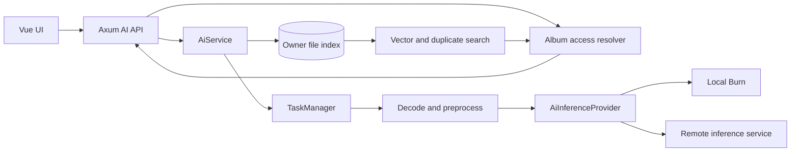
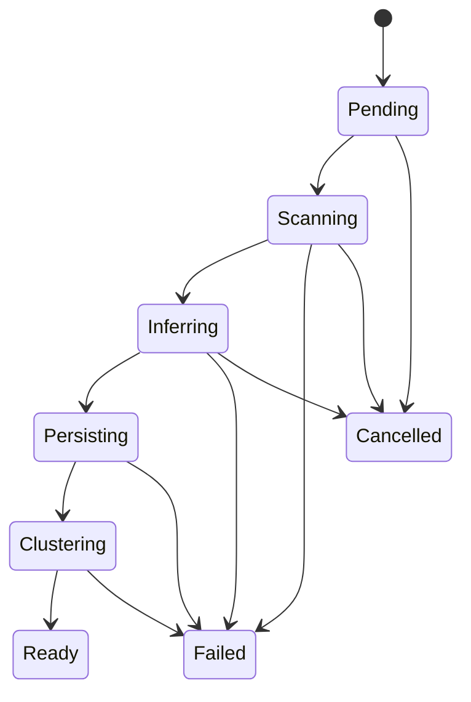

# AI 相似图像检索与人脸识别实施计划

## 1. 文档目的

本文定义 Lumeno 接入图像语义模型、人脸模型和重复照片检测的完整实施方案。目标不是只完成一次模型调用，而是建立一套可以在路由器环境长期运行、支持增量更新、严格遵守相册权限、能够替换模型和推理后端的 AI 能力。

本文覆盖：

- 以图搜图
- 中文和英文文字搜图
- 完全重复与近重复照片检测
- 人脸检测、人脸特征提取和人物聚类
- 人物命名、合并、拆分和隐藏
- 本地 Burn 推理与远程推理服务切换
- AI 索引持久化、增量更新、权限控制和故障降级
- 后端 API、前端工作流、测试、性能验证和发布步骤

## 2. 已确认决策

### 2.1 推理方式

后端提供统一的 `AiInferenceProvider` 抽象：

- 默认实现为 Lumeno Rust 进程内的本地 Burn provider。
- 可由管理员显式切换为远程推理 provider。
- 本地和远程 provider 必须返回相同语义的数据结构。
- provider 只负责模型推理，不负责用户认证、相册权限、索引持久化和人物关系维护。
- 远程模式不会被自动启用；本地模型故障时不得静默把照片发送到远程服务。

### 2.2 首版能力

首版包含：

- 从选中照片查找视觉相似照片。
- 使用中文或英文自然语言搜索照片。
- 查找字节完全相同的照片。
- 查找经过压缩、缩放、轻微裁剪或格式转换的近重复照片。
- 检测照片中的人脸并生成人脸特征。
- 自动形成未命名人物聚类。
- 允许相册 owner 命名、合并、拆分和隐藏人物。

### 2.3 权限规则

- AI 索引按照片 owner 存储，同一张照片只推理一次。
- 共享用户可以查看自己当前有权读取的照片对应的 AI 结果。
- 共享用户不能因为人物聚类或相似图结果看到 owner 的其他私有照片。
- 只有 owner 可以修改人物名称、人物归属、合并、拆分和隐藏状态。
- 即使共享用户具有相册写权限，也不能修改 owner 的人物库。
- 撤销共享后，相关 AI 查询结果必须立即不可见，不等待重新建索引。

### 2.4 持久化规则

- AI embedding、人脸框、人物关系不写入 XMP。
- AI 数据保存在 owner 级版本化文件索引中，不引入数据库。
- 机器生成的数据属于可重建缓存。
- 人物名称、人工合并、人工拆分和隐藏等用户决定需要备份，并在模型重建时尽可能迁移。

## 3. 目标与非目标

### 3.1 目标

1. 在不改变现有相册浏览与元数据索引语义的前提下增加 AI 检索。
2. 所有 AI 查询执行与现有相册 API 相同的认证和共享权限检查。
3. 新照片只进行增量推理，服务重启后不重复处理未变化照片。
4. 模型或 provider 可以替换，业务 API 和前端工作流不随模型变化。
5. AI 不可用时，文件、相册、缩略图和 XMP 功能仍然正常工作。
6. 首版能够在目标路由器资源范围内运行；无法满足资源预算时可以关闭本地 provider 并使用显式配置的远程 provider。
7. 所有耗时操作进入现有 `TaskManager`，前端可以显示进度和错误。

### 3.2 非目标

首版不包含：

- 通用物体检测或自动标签写入 XMP。
- 视频内容 embedding 和视频人脸识别。
- 跨 owner 合并人物身份。
- 自动删除重复照片。
- 在浏览器中运行模型。
- 实时文件系统 watcher。
- 云端模型自动回退。
- 根据人物姓名训练或微调模型。
- 将人脸识别用作登录认证。
- 在本仓库中实现完整的独立 Python 推理服务器。

## 4. 现有代码接入点

当前系统已经具备以下可复用边界：

- `src/backend/album.rs` 中的 `AlbumIndex` 和 `AlbumPhotoItem` 提供照片清单及 size、modified、日期和路径。
- `resolve_album_access` 负责解析自有相册和 `owner/album` 形式的共享相册。
- `collect_accessible_album_sources` 能枚举当前用户可以读取的全部相册。
- `RebuildIndexTask`、`TaskBase` 和 `TaskManager` 已提供后台任务、进度、错误和任务去重。
- 导入、上传、复制、删除和重建相册索引都有明确的后端完成点，可作为 AI 索引增量钩子。
- `SettingsManager` 支持持久化设置和设置变更 handler。
- `AlbumPanel.vue` 已有照片网格、照片详情、筛选、分页和批量选择。
- `useAlbumApp.js` 集中管理 API、相册状态和任务轮询。

因此 AI 实现应新增独立模块，而不是继续扩大 `album.rs`：

```text
src/backend/ai/
  mod.rs          服务编排和公共类型
  provider.rs     provider trait 与公共推理 DTO
  local.rs        本地 Burn 实现
  remote.rs       远程推理 client
  store.rs        文件 manifest、分片、原子提交和查询
  index.rs        增量索引流程
  duplicate.rs    SHA-256、pHash 和近重复判断
  people.rs       人物聚类及人工关系维护
  tasks.rs        AI 后台任务
  api.rs          HTTP API
```

## 5. 总体架构



关键原则：

1. API 在查询前先确定授权范围。
2. provider 看不到用户名、owner、相册名和磁盘路径。
3. store 不自行推断访问权限，调用方必须传入 allowed owner/album 集合。
4. 相册元数据索引是照片事实来源，AI 索引是派生索引。
5. 模型版本变化不会修改原始照片或 XMP。
6. 文件索引使用不可变分片和原子 manifest 切换，读取方不会观察到半写入状态。

## 6. Provider 抽象

### 6.1 Rust 接口草案

具体类型可以根据最终 Burn 版本和 backend 调整，但语义应保持稳定：

```rust
#[async_trait]
pub trait AiInferenceProvider: Send + Sync {
    fn provider_name(&self) -> &'static str;
    fn model_revision(&self) -> ModelRevision;
    fn capabilities(&self) -> AiCapabilities;

    async fn health(&self) -> Result<AiHealth, AiProviderError>;

    async fn embed_images(
        &self,
        images: &[PreparedImage],
    ) -> Result<Vec<ImageEmbedding>, AiProviderError>;

    async fn embed_texts(
        &self,
        texts: &[String],
    ) -> Result<Vec<TextEmbedding>, AiProviderError>;

    async fn detect_and_embed_faces(
        &self,
        images: &[PreparedImage],
    ) -> Result<Vec<Vec<DetectedFace>>, AiProviderError>;
}
```

`AiCapabilities` 至少包含：

```json
{
  "image_embedding": true,
  "text_embedding": true,
  "face_detection": true,
  "face_embedding": true,
  "max_batch_size": 8,
  "image_embedding_dimension": 512,
  "face_embedding_dimension": 512,
  "text_languages": ["zh", "en"]
}
```

`ModelRevision` 不能只使用展示名称，应包含足以判断索引兼容性的字段：

```json
{
  "image_model": "model-id@revision",
  "image_preprocess": "rgb-224-v1",
  "face_detector": "model-id@revision",
  "face_embedder": "model-id@revision",
  "face_preprocess": "aligned-112-v1"
}
```

任意会改变向量空间、输入方向、裁剪或归一化方式的修改都必须改变 revision。

### 6.2 输入规范

业务层在调用 provider 前完成：

1. 安全解析图片格式。
2. 应用 EXIF Orientation，确保视觉方向一致。
3. 将图片转换为 sRGB/RGB8。
4. 限制解码像素总数，防止解压炸弹。
5. 按 provider 能力生成受尺寸限制的 `PreparedImage`。

provider 内部完成模型特有的 resize、crop、mean/std 和 tensor layout 转换。

RAW 图片优先复用现有可生成的 JPEG 预览。没有可用预览时，将该照片记录为不支持，而不是让整个任务失败。

### 6.3 输出规范

- 图像和文本 embedding 必须是 L2 归一化后的有限 `f32` 数组。
- provider 返回向量前检查维度、NaN 和 Infinity。
- 人脸框使用相对于原始方向修正后图片的 `[0,1]` 坐标。
- 人脸结果包含 detection score、quality score、landmarks 和 embedding。
- 同一批输入的输出数量和顺序必须严格一致。
- 部分输入失败时使用逐项错误结构，避免一张坏图丢弃整个批次；provider 级故障仍返回整体错误。

### 6.4 本地 Burn provider

`LocalBurnProvider` 使用 Burn 定义模型结构并执行推理，不链接 ONNX Runtime，也不在运行时读取 ONNX 文件。要求如下：

- 图文编码器、人脸检测器和人脸特征编码器分别实现为 Burn `Module`。
- 权重使用 Burn record 或 Safetensors；生产包不包含 ONNX 文件。
- 首版 CPU backend 优先选择 Burn 的纯 Rust CPU backend，并通过目标路由器 benchmark 确认。可选 WGPU backend 必须作为独立 Cargo feature，不能成为无 GPU 路由器的硬依赖。
- backend、device 和张量 dtype 在 provider 初始化时确定，模型实例在启动或首次使用时加载并复用。
- 模型加载、图片预处理和同步推理放入专用阻塞线程或工作队列，不能阻塞 Tokio worker。
- 使用独立 `ConcurrencyLimiter` 控制并发。
- batch size 不超过模型能力、backend 内存预算和管理员设置。
- 限制同时处于解码、预处理和推理阶段的图片数量。
- 模型缺失、checksum 不匹配、record 不兼容或 backend 初始化失败时，provider 状态为 unavailable。

模型文件建议布局：

```text
dist/models/
  manifest.json
  image-text.mpk
  tokenizer.json
  face-detector.mpk
  face-embedder.mpk
```

`.mpk` 仅表示示例 Burn record 格式；最终扩展名取决于选定的 Burn recorder。若使用 Safetensors，manifest 必须明确记录格式和 dtype。

预训练权重转换是离线发布步骤：从许可证允许的原始权重转换为 Burn record 或 Safetensors，随后用固定输入比对参考输出。实现不依赖 ONNX 导入链路，也不在用户设备执行模型转换。

不能把数百 MB 权重直接 `include_bytes!` 到 Rust 二进制中，否则会增加发布、升级和路由器存储压力。

Cargo 依赖按 feature 隔离：

```text
ai-burn-cpu     默认的 Burn CPU backend、模型模块和 recorder
ai-burn-wgpu    可选 WGPU backend，不进入路由器默认构建
```

不启用任何 ONNX runtime 或 ONNX importer feature。Burn 模型模块可以对 backend 泛型化，但 `AppState` 中保存的仍是擦除具体 backend 后的 `Arc<dyn AiInferenceProvider>`；启动时根据编译 feature 构造一个具体 `LocalBurnProvider<B>`。首版不支持在同一二进制运行时切换 CPU/WGPU backend，避免把多个重型 backend 同时打包。

CPU 推理可以使用 `f32`，磁盘索引仍可独立压缩为 `f16`。写分片时将归一化后的 `f32` embedding 转为 IEEE binary16，查询时按块转回 `f32` 计算；这不要求 Burn CPU backend 用半精度执行模型。

### 6.5 远程 provider

远程 provider 使用版本化协议。建议基础路径为：

```text
/v1/health
/v1/capabilities
/v1/embeddings/images
/v1/embeddings/texts
/v1/faces/analyze
```

图片使用 `multipart/form-data` 二进制字段，不使用 JSON base64。请求包含模型 revision 期望值，响应返回实际 revision。client 必须限制：

- 连接超时
- 单批请求超时
- 最大响应体
- 最大图片数量和单图字节数
- 最大重试次数
- 只重试明确可重试的网络错误和 5xx

远程 bearer token 只从 `AI_REMOTE_TOKEN` 环境变量读取。当前 `/api/settings` 会把设置返回给前端，因此 token 不能存入 `settings.json`。

远程协议单独记录在后续新增的 `docs/ai-provider-api.md` 中，Rust client 使用 mock HTTP server 做 contract test。

## 7. 模型选择与模型清单

### 7.1 图文模型

图文模型必须满足：

- 图片和文本位于同一向量空间。
- 中文、英文查询均可用。
- 有明确的推理和再分发许可证。
- 模型结构能够用 Burn 原生模块表达，预训练权重能够合法转换为 Burn record 或 Safetensors。
- 在目标路由器的 CPU 和内存上达到可接受性能。

候选模型应通过固定样本集比较，而不是只根据公开 benchmark 决定。样本至少覆盖：

- 人物、宠物、食物、建筑、自然风景、夜景、文档截图。
- 中文和英文同义查询。
- 横竖图、低光、模糊、不同分辨率。
- 与真实个人相册接近的非精选照片。

### 7.2 人脸模型

建议职责拆分：

- SCRFD 或 RetinaFace 类模型负责人脸检测和 landmarks。
- ArcFace 类模型负责对齐后的人脸 embedding。

选择时验证：

- 小脸和侧脸召回率。
- 亚洲人脸样本的区分度。
- 多年龄阶段照片的稳定性。
- CPU 推理时间和峰值内存。
- 模型许可证与可再分发条件。

### 7.3 Manifest

`dist/models/manifest.json` 示例：

```json
{
  "schema_version": 1,
  "models": {
    "image_text": {
      "id": "candidate-model",
      "revision": "immutable-revision",
      "file": "image-text.mpk",
      "format": "burn-record",
      "sha256": "...",
      "input_size": [224, 224],
      "embedding_dimension": 512,
      "license": "verified-license"
    },
    "face_detector": {
      "id": "candidate-detector",
      "revision": "immutable-revision",
      "file": "face-detector.mpk",
      "format": "burn-record",
      "sha256": "..."
    },
    "face_embedder": {
      "id": "candidate-embedder",
      "revision": "immutable-revision",
      "file": "face-embedder.mpk",
      "format": "burn-record",
      "sha256": "...",
      "embedding_dimension": 512
    }
  }
}
```

文档不能提前锁死未经路由器验证的模型。最终模型 ID、revision 和许可证应在 Phase 0 探针与质量 gate 通过后写入 `docs/ai-models.md`。

## 8. AI 索引存储

### 8.1 文件边界

不使用 SQLite、嵌入式 KV 或外部数据库。每个 owner 使用一个独立目录：

```text
dist/data/config/{owner}/ai/
  CURRENT
  generations/
    00000001/
      manifest.json
      photos.meta
      image-vectors.f16
      hashes.bin
      faces.meta
      face-vectors.f16
      people.json
      assignments.json
      clusters.json
      errors.json
```

原因：

- 与当前用户文件根目录和 owner 权限模型一致，删除和迁移用户时边界清晰。
- 同一 owner 的跨相册人物可以形成统一人物库。
- 不会因为共享给多个用户而重复保存 embedding。
- 定长向量文件可顺序读取或内存映射，精确检索不需要反序列化大型 JSON 数组。
- generation 目录天然支持原子发布和故障回滚。

`CURRENT` 只包含当前 generation 名称。写入流程先在临时 generation 中生成全部文件、flush 并校验 checksum，再通过同文件系统 rename 原子替换 `CURRENT`。旧 generation 在没有活跃 reader 后由 GC 删除。API handler 只调用 `AiIndexStore`，不能自行读写这些文件。

### 8.2 文件职责

`manifest.json` 保存：

- schema version、generation 和 owner。
- 图像及人脸模型 revision。
- embedding 维度、dtype、端序和记录数。
- 各数据文件的字节数与 SHA-256。
- 创建时间、完整或增量构建来源和索引状态。

`photos.meta`：

- 使用长度前缀的二进制记录或 MessagePack/CBOR 等有边界的结构化格式。
- 保存照片 ID、album、path、size、modified、宽高、indexed_at、错误引用和向量 offset。
- 照片 ID 是 generation 内部紧凑整数；稳定身份仍是 `(album, path)`。

`image-vectors.f16`：

- 按 photo ID 顺序保存定长 little-endian IEEE 754 binary16 向量。
- 缺少向量的照片在 metadata 中使用无效 offset，不写占位向量。
- 检索加载后转换为 `f32` 累加 dot product，避免 `f16` 累加精度不足。

`hashes.bin`：

- 每个已完成哈希的照片保存 32 字节 SHA-256 和 8 字节 pHash。
- metadata 保存对应 offset 和有效位。

`faces.meta` 与 `face-vectors.f16`：

- metadata 保存 face UUID、photo ID、box、5 点 landmarks、检测分、质量分和向量 offset。
- face embedding 使用与图像向量相同的定长 `f16` 分片策略。

`people.json` 与 `assignments.json`：

- 数据规模显著小于向量，可使用人类可检查的 JSON。
- 保存人物姓名、隐藏状态和 face assignment。
- assignment source 使用 `automatic`、`manual_name`、`manual_merge`、`manual_split`。
- 自动聚类不得覆盖人工 assignment。

`clusters.json` 和 `errors.json` 属于可重建数据，分别保存自动聚类建议和逐项索引错误。

### 8.3 内存目录与查询

打开 generation 时构建轻量内存目录：

- `(album, path) -> photo_id`
- `photo_id -> metadata offset`
- `SHA-256 -> photo_id list`
- `person_id -> face_id list`
- `face_id -> assignment`

向量文件不默认完整复制到堆内存。优先使用只读 memory map 或分块读取，具体方式需要在目标路由器验证；若平台不适合 mmap，则使用受限大小的分片 cache。

首版 `VectorIndex` 实现顺序扫描授权 photo ID 对应的定长向量。访问控制先产生 allowed photo ID bitmap/set，向量扫描只对 allowed ID 计分。

### 8.4 一致性与增量写入

不原地修改当前 generation。一次增量任务：

1. 固定读取当前 generation 快照。
2. 为未变化记录复用 metadata 和向量字节。
3. 为新增或变化照片生成新记录。
4. 排除已经删除的照片及其 face。
5. 将完整的新 generation 写入临时目录。
6. 校验记录数、offset、文件长度、向量维度和 checksum。
7. 原子切换 `CURRENT`。

这样不依赖数据库事务，并保证崩溃后要么继续读取旧 generation，要么完整读取新 generation。为了避免每次新增一张照片复制整个大向量文件，generation 可以引用若干不可变 shard：新 generation 的 manifest 复用旧 shard，只新增 delta shard；后台 compaction 在 shard 数或删除比例超过阈值时合并。manifest 切换仍是唯一提交点。

### 8.5 向量格式与精度

磁盘默认使用 `f16`，推理和相似度累加使用 `f32`：

- 512 维 `f32` 向量：$512 \times 4 = 2048$ 字节。
- 512 维 `f16` 向量：$512 \times 2 = 1024$ 字节。
- 768 维 `f16` 向量：$768 \times 2 = 1536$ 字节。

embedding 已 L2 归一化。写入和读取时检查长度、NaN、Infinity 和接近零范数。`f16` 对相似度召回的影响必须用固定数据集验证；如果选定模型对量化敏感，可由 manifest 把 dtype 改为 `f32`，不能混读不同 dtype。

暂不默认使用 int8 embedding。int8 可以把 512 维向量降到约 512 字节并附加 scale，但会增加量化校准、跨 backend 一致性和召回风险，只有 benchmark 与质量测试证明必要时再增加。

### 8.6 每张照片的磁盘占用估算

以下估算只计算 AI 派生索引，不包含原图、缩略图、Burn 本身、模型权重、tokenizer 和文件系统 block rounding。模型权重是每台设备一份固定成本，不随照片数量线性增长；具体大小取决于最终图文模型与人脸模型，必须单独测量。假设：

- 图像 embedding 为 512 维。
- 每张人脸 embedding 为 512 维。
- 路径、album、offset、size、mtime、宽高、标志和记录边界平均占 180 至 350 字节；长路径会更高。
- SHA-256 为 32 字节，pHash 为 8 字节。
- 每张人脸的 UUID、photo ID、box、5 点 landmarks、两个 score、offset 和记录边界约 100 至 180 字节。
- shard manifest、人物 JSON、checksum 和索引目录开销按规模摊销约 5% 至 15%。小相册因固定文件和 JSON 开销，单图均值可能更高。

使用 `f16` 时，单图基础成本近似为：

$$
S_{photo} \approx 1024 + 40 + M_{photo} + F \times (1024 + M_{face}) + O
$$

其中 $F$ 是该照片保留的人脸数，$M_{photo}$ 约为 180 至 350 字节，$M_{face}$ 约为 100 至 180 字节，$O$ 是 5% 至 15% 的摊销开销。

经验预算如下：

| 每张照片保留人脸数 | `f16` 预计占用 | `f32` 预计占用 |
| ---: | ---: | ---: |
| 0 | 1.3 至 1.6 KiB | 2.3 至 2.8 KiB |
| 0.5（平均两张照片一张脸） | 1.9 至 2.3 KiB | 3.4 至 4.0 KiB |
| 1 | 2.4 至 3.0 KiB | 4.5 至 5.3 KiB |
| 2 | 3.6 至 4.3 KiB | 6.7 至 7.8 KiB |
| 5 | 7.0 至 8.4 KiB | 13.3 至 15.3 KiB |

按默认 `f16`、平均每张照片 1 张保留人脸估算。下表沿用便于做容量预算的保守范围，实际值由路径长度、被质量阈值过滤的人脸数和 shard 压实率决定：

| 照片数量 | AI 索引预计占用 |
| ---: | ---: |
| 1,000 | 2.5 至 2.9 MiB |
| 10,000 | 24 至 29 MiB |
| 50,000 | 120 至 145 MiB |
| 100,000 | 240 至 290 MiB |

若多数照片没有人脸，100,000 张照片更接近 130 至 160 MiB；若合照很多，实际值会明显增加。使用 768 维模型时，每个图像或人脸向量比 512 维 `f16` 多 512 字节；平均每图一张脸时，单图再增加约 1 KiB。

内存占用与磁盘占用不同。若把 100,000 个 512 维 `f16` 图像向量全部转为 `f32` 常驻内存，仅图像矩阵约为：

$$
100000 \times 512 \times 4 \approx 195.3\ \text{MiB}
$$

再加人脸向量会翻倍或更多。因此路由器实现不能默认把全部图像和人脸向量展开成 `f32` 常驻内存，应使用 mmap/分片扫描和有上限的查询缓冲区。

容量规划可以采用以下简化结论：

- 不做人脸识别：按每张照片 1.6 KiB 预留。
- 开启人脸识别，平均每图 1 张保留人脸：按每张照片 3 KiB 预留。
- 家庭合照较多，平均每图 2 张保留人脸：按每张照片 4.5 KiB 预留。
- 无法预估相册结构时，稳态按每张照片 4 KiB 做首轮预算，再用真实索引统计修正。

generation 全量重建或 shard compaction 期间，新旧文件会短时并存。除模型权重外，AI 数据目录应至少预留稳态索引的 2 倍空间，并额外保留约 10% 安全余量。例如 100,000 张、平均每图 1 张人脸时，稳态约 240 至 290 MiB，重建期间建议仅为索引预留约 550 至 650 MiB。模型权重是额外固定成本，不包含在这个数字内。

### 8.7 备份语义

文件索引中的数据分两类：

- 可重建：照片 embedding、SHA-256、pHash、人脸框、人脸 embedding、自动聚类建议。
- 用户数据：人物名称、隐藏状态、人工合并和拆分关系。

备份文档必须明确包含 `dist/data/config/{owner}/ai/`。`people.json` 和 `assignments.json` 必须在重建前复制到新 generation，并通过稳定照片键、人脸框 IoU 迁移；不能因为清理旧 shard 删除人工决定。

## 9. 增量索引生命周期

### 9.1 照片稳定键

AI 索引中的照片稳定键为：

```text
(owner, album, path)
```

owner 由索引目录隐含，因此 owner 目录内的稳定键使用 `(album, path)`。

快速变化判断使用：

```text
(path, size_bytes, modified_seconds, model_revision)
```

这不是安全内容哈希，只用于决定是否可以跳过解码和推理。完全重复检测需要单独计算流式 SHA-256。

### 9.2 索引任务流程



`AiIndexTask` 执行步骤：

1. 解析 owner 和相册，并再次检查发起者权限。
2. 读取现有 `AlbumIndex`，不重新递归扫描整个文件系统。
3. 对比当前 generation 中的照片键、size、modified 和模型 revision。
4. 在新 generation 中排除已经不在相册索引内的照片及关联人脸。
5. 对新增或变化照片生成安全预览。
6. 分批计算 SHA-256、pHash、图像 embedding 和人脸结果。
7. 每批结果写入临时 delta shard，并更新临时 manifest；任务完成前不切换 `CURRENT`。
8. 对单张失败写入 `errors.json` 并继续处理其他照片。
9. 完成本次新增人脸的聚类建议。
10. 更新任务状态和索引 revision。

### 9.3 任务去重

deduplication key：

```text
ai-index:{owner}:{album}:{requested-revision}
```

同一 owner、相册和 revision 只允许一个 Pending、Running 或 Paused 任务。全量 owner 任务由多个相册子步骤组成，但不能与相同相册的单独任务并发写入。

### 9.4 取消

现有 `Task` 支持 `cancel`，但任务需要协作式检查取消标志：

- 每张图片开始前检查。
- 每个 batch 推理前后检查。
- 每个临时 shard flush 前后检查。
- `CURRENT` 原子切换前检查。
- 已完成但尚未发布的临时 shard 可以删除；已经发布的 generation 保留。

取消不会回滚已成功生成的索引，因为这些结果仍然有效。

### 9.5 变更钩子

以下流程成功后排队增量 AI 索引：

- 本地上传导入相册完成。
- 从文件区导入相册完成。
- 复制照片到另一相册完成。
- 相册元数据索引重建完成。

以下流程同步清理或在文件操作成功后排队清理：

- 删除照片。
- 删除相册。
- 删除用户。

修改评分、标签、色标和普通 XMP 内容不会使视觉 embedding 失效。

用户绕过 Lumeno 直接修改磁盘文件时，首版不实时监听。下一次相册索引重建和 AI 增量任务通过 size/modified 收敛。

### 9.6 模型升级

当 image model revision 改变：

- 图像 embedding 标为 stale。
- 文字搜索和以图搜图不可混用新旧向量。
- SHA-256 和 pHash 仍然有效。

当 face model revision 改变：

- 人脸框和 embedding 标为 stale。
- 人物名称和人工关系暂时保留。
- 新模型重建后，按照片稳定键和人脸框 IoU 迁移人工关系。
- 无法唯一匹配的关系进入待确认状态，不自动猜测。

## 10. 相似图像与文字检索

### 10.1 相似度

图像和文本向量都进行 L2 归一化，使用余弦相似度：

$$
\operatorname{similarity}(a,b)=a\cdot b
$$

首版使用精确扫描：

1. 根据权限和 scope 从 owner generation 的 metadata 取得授权 photo ID，并定位对应 embedding 分片。
2. 在 Rust 中计算 dot product。
3. 使用固定最小分数过滤。
4. 按 score 降序，再按 `(owner, album, path)` 稳定排序。
5. 截断到请求 limit。

这避免首版引入难以交叉编译的原生 ANN 扩展。实现时仍定义 `VectorIndex` trait，使未来可以增加纯 Rust HNSW 或分片索引，而不修改 API。

### 10.2 以图搜图

- 源照片必须属于请求者可读相册。
- 优先复用源照片已经保存的 embedding。
- 如果源照片未索引，返回 `not_indexed`，并可提示 owner 启动索引；普通共享用户不能隐式触发 owner 的批量推理。
- 默认排除源照片自身。
- `scope=current_album` 只搜索当前相册。
- `scope=accessible` 搜索请求者当前可读的全部相册，可跨 owner 打开多个只读 generation snapshot。

### 10.3 文字搜图

- 限制文本长度，例如 1 至 256 个 Unicode scalar values。
- trim 后为空直接返回 400。
- 文本不持久化到索引文件，不写日志正文。
- 文本 embedding 可以使用小型内存 LRU，key 包含模型 revision 和规范化文本。
- 中英文查询使用同一多语言图文模型。

### 10.4 阈值

相似度阈值不能直接写死为跨模型常量。设置应提供：

- 模型 manifest 的推荐默认值。
- 管理员可调整的安全范围。
- API 返回原始 score 和可展示的 reason，但前端不宣称 score 是概率。

## 11. 完全重复与近重复

### 11.1 完全重复

完全重复定义为文件内容 SHA-256 相同。流程：

1. 以流式读取计算 SHA-256，避免整文件进内存。
2. 按 SHA-256 分组。
3. 只返回至少两个当前可见成员的组。

### 11.2 近重复

近重复不能只使用语义 embedding，否则同一场景的不同照片会被误判为重复。推荐两阶段判断：

1. 对应用方向后的缩略图计算 pHash，根据 Hamming distance 召回候选。
2. 使用宽高比、尺寸信息和视觉 embedding 相似度复核。

判定结果分为：

- `exact`：SHA-256 相同。
- `near`：pHash 和视觉条件均通过。
- `similar`：只在语义向量上接近，不属于重复组。

近重复阈值通过测试素材校准，至少包含：

- JPEG 质量变化。
- 缩放。
- 格式转换。
- 轻微旋转和裁剪。
- 加边框或轻微调色。
- 连拍但内容不同的负样本。

### 11.3 删除规则

系统不提供“自动删除全部重复项”。前端只负责分组、比较和选择，最终删除仍调用现有删除 API，并遵守 `can_delete`。

## 12. 人脸检测与人物聚类

### 12.1 人脸处理流水线

1. 在方向修正后的图片上检测人脸和 landmarks。
2. 丢弃低 detection score、人脸尺寸过小或质量过低的结果。
3. 根据 landmarks 对齐并裁剪人脸。
4. 生成人脸 embedding 并 L2 归一化。
5. 保存人脸框、质量、模型 revision 和 embedding。
6. 对没有人工人物归属的人脸运行聚类。

人物封面默认选择：

- 当前请求者有权读取。
- quality score 较高。
- 人脸尺寸较大。
- 在分数相同时按稳定照片键排序。

### 12.2 自动聚类

应使用成熟的密度聚类实现，而不是手写“相似度超过阈值就合并”。候选可以是 DBSCAN/HDBSCAN 类算法，距离使用余弦距离：

$$
d(a,b)=1-a\cdot b
$$

聚类要求：

- 小于最小样本数的人脸保留为未知候选。
- 不强制每张脸进入某个人物。
- algorithm revision 和阈值写入 cluster suggestion。
- 自动聚类只产生建议或 `automatic` assignment。
- 人工归属具有更高优先级。

### 12.3 人工操作

命名：

- 修改 `people.name`。
- 名称 trim 后不能为空，限制长度。
- 同一 owner 可以存在重名人物，但 UI 应避免误操作。

合并：

- owner 选择多个 person，指定保留的目标 person。
- 在内存中生成完整的新人物关系快照，校验一个 face 最多属于一个 person 后，原子写入新的 `people.json` 和 `assignments.json` generation。
- 保留目标名称，其他名称可以记录到操作审计或直接丢弃，首版采用明确确认文案。

拆分：

- owner 从人物详情选择一组 face。
- 创建新 person，并把选中 face 标记为 `manual_split`。
- 未选中 face 保留在原人物。

隐藏：

- 隐藏人物默认不出现在人物列表。
- 不删除 face 或 embedding。
- owner 可以通过“显示已隐藏人物”恢复。

### 12.4 跨相册与跨 owner

- 同一 owner 的人物可以跨该 owner 的多个相册聚类。
- 不跨 owner 聚类或合并人物。
- 请求者查看共享人物时，只能看到当前可读相册中的 face 和照片。
- 返回的可见照片数按请求者实时授权范围计算，不能返回 owner 全库 count。

## 13. 权限矩阵

| 操作 | Owner | 只读共享用户 | 可写共享用户 | 无权限用户 | 管理员但无相册访问权 |
| --- | --- | --- | --- | --- | --- |
| 查看相似结果 | 是 | 是，仅共享范围 | 是，仅共享范围 | 否 | 否 |
| 文字搜索 | 是 | 是，仅可访问范围 | 是，仅可访问范围 | 否 | 仅管理员身份不授予照片权限 |
| 查看重复组 | 是 | 是，仅共享范围 | 是，仅共享范围 | 否 | 否 |
| 查看人物 | 是 | 是，仅共享范围 | 是，仅共享范围 | 否 | 否 |
| 启动 owner AI 索引 | 是 | 否 | 可选，首版建议否 | 否 | 否 |
| 人物命名 | 是 | 否 | 否 | 否 | 否 |
| 合并、拆分、隐藏人物 | 是 | 否 | 否 | 否 | 否 |
| 配置 provider | 管理员且是站点管理员 | 否 | 否 | 否 | 是 |

管理员角色只允许配置全局 AI provider，不自动获得其他用户照片或人物数据读取权。

API 权限实现顺序：

1. 通过 session 得到当前 username 和 role。
2. 使用 `resolve_album_access` 或 `collect_accessible_album_sources` 构建 allowed scope。
3. 将 allowed `(owner, album)` 集合传给查询服务。
4. store 只返回该集合内照片。
5. 返回前再次保证缩略图所需 owner/album/path 与授权对象一致。

禁止先查询 owner 全库结果，再依赖前端过滤。

## 14. HTTP API 设计

所有响应继续使用现有 `create_response` 外层格式。以下只展示 `data`。

### 14.1 AI 状态

```text
GET /api/ai/status
```

普通用户只看到自身可访问范围的摘要；管理员额外看到 provider 状态。

```json
{
  "state": "ready",
  "capabilities": {
    "image_search": true,
    "text_search": true,
    "duplicates": true,
    "faces": true
  },
  "accessible": {
    "indexed_photos": 1200,
    "pending_photos": 12,
    "people": 48
  },
  "provider": {
    "kind": "local",
    "healthy": true,
    "model_revision": "..."
  }
}
```

非管理员响应省略 provider URL、底层错误详情和部署路径。

状态枚举：

- `disabled`
- `not_indexed`
- `indexing`
- `ready`
- `stale`
- `unavailable`

### 14.2 启动索引

```text
POST /api/ai/index
Content-Type: application/json
```

```json
{
  "album": "family",
  "mode": "incremental",
  "features": ["image", "duplicates", "faces"]
}
```

响应：

```json
{
  "task_id": "uuid",
  "created": true
}
```

`mode` 支持：

- `incremental`：默认，只处理变化项。
- `rebuild`：忽略机器生成结果重新推理，但保留并迁移人工人物关系。

### 14.3 以图搜图

```text
POST /api/ai/search/similar
```

```json
{
  "album": "family",
  "path": "albums/family/2025/2025-04-01/photo.jpg",
  "scope": "accessible",
  "limit": 60,
  "min_score": null
}
```

响应：

```json
{
  "query": {
    "kind": "image",
    "owner": "daniel",
    "album": "family",
    "path": "albums/family/2025/2025-04-01/photo.jpg"
  },
  "results": [
    {
      "owner": "daniel",
      "album": "travel",
      "path": "albums/travel/2025/2025-04-02/other.jpg",
      "name": "other.jpg",
      "date": "2025-04-02",
      "size": 123456,
      "score": 0.82,
      "reason": "visual_similarity"
    }
  ]
}
```

### 14.4 文字搜图

```text
POST /api/ai/search/text
```

```json
{
  "text": "海边日落",
  "scope": "accessible",
  "album": null,
  "limit": 60,
  "min_score": null
}
```

响应结果与以图搜图一致，`query.kind` 为 `text`。响应可以回显规范化文本，但服务日志不记录原始查询正文。

### 14.5 重复照片

```text
GET /api/ai/duplicates?scope=accessible&album=family&kind=all&offset=0&limit=20
```

```json
{
  "groups": [
    {
      "id": "stable-group-id",
      "kind": "exact",
      "confidence": 1.0,
      "potential_savings": 123456,
      "photos": []
    }
  ],
  "total_count": 4
}
```

group ID 只用于当前索引 revision 下的 UI key，删除操作仍必须传真实 album/path 并重新鉴权。

### 14.6 人物列表

```text
GET /api/ai/people?include_hidden=false&offset=0&limit=100
```

```json
{
  "people": [
    {
      "id": "uuid",
      "name": "",
      "hidden": false,
      "visible_photo_count": 32,
      "cover": {
        "owner": "daniel",
        "album": "family",
        "path": "albums/family/photo.jpg",
        "face_box": [0.2, 0.1, 0.3, 0.3]
      },
      "editable": true
    }
  ],
  "total_count": 48
}
```

### 14.7 人物照片

```text
GET /api/ai/people/{person_id}/photos?offset=0&limit=100
```

只返回当前请求者可读照片。若人物存在但当前用户没有任何可见 face，返回 404，避免泄漏人物存在性。

### 14.8 修改人物

```text
PATCH /api/ai/people/{person_id}
```

```json
{
  "name": "Alice",
  "hidden": false
}
```

仅 owner 可调用。

### 14.9 合并人物

```text
POST /api/ai/people/merge
```

```json
{
  "target_person_id": "uuid-a",
  "source_person_ids": ["uuid-b", "uuid-c"]
}
```

所有 person 必须属于同一 owner，且调用者是该 owner。

### 14.10 拆分人物

```text
POST /api/ai/people/split
```

```json
{
  "source_person_id": "uuid-a",
  "face_ids": ["face-1", "face-2"],
  "new_name": ""
}
```

face 必须全部属于 source person。操作先在内存副本上完成并校验，再通过新 generation 原子发布，不能产生一个 face 同时属于两个人物。

## 15. 设置设计

建议设置键：

| 键 | 默认值 | 说明 |
| --- | --- | --- |
| `ai_enabled` | `false`，通过目标设备验证后再考虑改为 true | 全局启用 AI |
| `ai_provider` | `local` | `local` 或 `remote` |
| `ai_remote_url` | 空 | 远程服务基础 URL |
| `ai_batch_size` | 4 | 推理批量，限制在 capability 范围 |
| `ai_concurrency` | 1 | 同时推理任务数 |
| `ai_face_detection_threshold` | manifest 默认 | 人脸检测阈值 |
| `ai_face_quality_threshold` | manifest 默认 | 人脸质量阈值 |
| `ai_people_cluster_threshold` | manifest 默认 | 聚类距离阈值 |
| `ai_similarity_threshold` | manifest 默认 | 图文检索最低分 |

`SettingsManager` 增加 typed getter 和范围校验，不能让任意 JSON 值直接进入模型执行参数。

provider 设置变化时：

1. 验证新配置。
2. 创建新 provider 并执行 health。
3. 成功后原子替换 `Arc<dyn AiInferenceProvider>`。
4. 对模型 revision 不兼容的索引标记 stale。
5. 失败则保留旧 provider，设置页显示错误。

remote URL 应限制为 `http`/`https`，并在文档中说明局域网明文 HTTP 会暴露照片内容。生产环境建议 HTTPS 或受信任的本机/局域网网络。

## 16. 前端设计

### 16.1 状态管理

在 `useAlbumApp.js` 中增加独立状态：

```text
aiStatus
aiStatusLoading
aiResultMode          none | similar | text | duplicates
aiResults
aiQuery
aiResultLoading
duplicateGroups
people
peopleLoading
selectedPerson
personPhotos
```

AI 搜索不能把 score、人物或 source photo 塞进现有 `albumFilters`。现有筛选代表相册元数据约束，AI 查询是独立结果模式。

AI 结果项保持 `AlbumPhotoItem` 所需字段，并增加 `owner`、`album`、`score`、`reason`，从而复用：

- `VirtualGrid`
- `LazyImage`
- 照片详情
- 批量选择
- 缩略图 URL 生成

### 16.2 文字搜图

在相册工具栏加入：

- 搜索输入框。
- scope 菜单：当前相册/所有可访问相册。
- 搜索按钮和清除按钮。
- 索引不可用、正在索引、没有结果状态。

文字搜索提交后进入 AI result mode。页面显示查询词和结果数量，返回操作恢复之前的普通相册列表状态，不重新创建另一套照片浏览器。

### 16.3 查找相似

照片详情动作区增加带图标按钮“查找相似照片”：

- 默认搜索所有可访问相册。
- 关闭详情后在原相册工作区显示结果。
- 结果顶部展示源照片缩略图和 scope。
- score 只作为排序和辅助信息，不显示为“82% 相同概率”。

### 16.4 重复照片视图

重复视图按组展示：

- `完全重复` 或 `近重复` 标签。
- 每张照片的相册、文件名、尺寸、日期。
- 组内总大小和潜在节省空间。
- 打开详情、选择照片、调用现有删除流程。

系统不能默认勾选“保留一张、删除其他全部”。对于共享相册，删除按钮继续取决于 `can_delete`。

### 16.5 人物工作区

新建 `PeoplePanel.vue`，并在 `AppSidebar.vue` 增加顶层“人物”导航。

人物列表：

- 使用人脸裁剪封面，而不是整张照片缩略图。
- 显示姓名或“未命名”。
- 显示当前用户可见照片数。
- 支持隐藏人物过滤。
- 使用稳定尺寸网格，避免人脸封面加载造成布局跳动。

人物详情：

- 复用照片网格。
- owner 可命名、合并、选择 face 拆分和隐藏。
- 共享用户只看到只读界面。
- 拆分操作必须明确选择具体人脸，而不是只选择照片；一张合照可能包含多个人物。

### 16.6 设置页

管理员设置新增 AI section：

- 启用开关。
- local/remote segmented control。
- 远程 URL。
- batch size 和 concurrency 数值控件。
- provider health、capabilities 和模型 revision。
- 测试连接按钮。
- 重建全部 AI 索引按钮。
- 模型缺失、索引 stale 和最近错误。

token 只显示“已通过环境变量配置/未配置”，不显示具体值。

### 16.7 国际化与可访问性

更新：

- `frontend/src/i18n/en.js`
- `frontend/src/i18n/zh.js`
- `locales/en.yml`
- `locales/zh.yml`

覆盖状态、任务、错误、人物操作、重复类型和隐私提示。图标按钮提供 title/aria-label，人物姓名输入和危险操作对话框支持键盘操作。

## 17. 错误处理与降级

### 17.1 Provider 不可用

- 主服务继续启动。
- AI API 返回结构化 `unavailable` 错误。
- 已有普通相册功能不受影响。
- 设置页显示管理员可处理的错误摘要。
- 不向普通用户泄漏动态库路径、远程 URL token 或堆栈。

### 17.2 单张图片失败

- 在 `photos.item_error` 记录稳定错误分类和简短消息。
- 任务继续处理其他照片。
- 状态接口返回失败计数。
- 后续照片发生变化或管理员重试时重新处理。

错误分类建议：

- `unsupported_format`
- `decode_failed`
- `image_too_large`
- `preview_unavailable`
- `provider_rejected`
- `invalid_output`

### 17.3 索引文件损坏

- 读取 generation 时验证 manifest、文件长度、record offset、向量维度和文件 checksum。
- 当前 generation 损坏时尝试只读回退到上一份 checksum 完整的 generation，并将状态标记为 degraded。
- 不自动覆盖可能包含人物名称和人工 assignment 的文件。
- 没有可用 generation 时将 AI 索引置为 unavailable，并提示管理员备份后重建。
- 提供导出人物人工关系的维护工具后，才允许自动化恢复流程。

### 17.4 索引版本不兼容

- schema migration 写入全新的 generation，通过全部校验后才原子切换 `CURRENT`。
- migration 失败保留旧 generation 和原 `CURRENT`。
- 新版本服务可以把机器索引标为 stale，但不能静默删除人工人物关系。

## 18. 安全与隐私

人脸 embedding 是敏感生物特征派生数据，应按敏感用户数据处理：

- 数据只保存在 `dist/data/config/{owner}/ai/`。
- 目录权限与现有用户数据一致。
- 不写普通请求日志。
- 不返回给浏览器；前端只接收 person/face ID、人脸框和授权照片信息。
- 不允许下载原始 embedding 的公共 API。
- 备份说明明确包含 AI 数据。
- 删除用户时删除其 owner AI 索引目录。
- 远程 provider 仅在管理员明确启用时发送处理后的图片。

建议远程模式提供隐私提示：图片内容将被发送到配置的推理服务。Lumeno 不应假设该服务是可信的。

API 还需要：

- 文本长度和 limit 上限。
- 图片解码像素上限。
- 请求并发限制。
- 路径规范化和相册边界检查。
- 远程响应维度、数量和数值合法性检查。
- 不在错误信息中回显绝对路径。

## 19. 性能与资源预算

在确认路由器硬件前不写死最终数值，但实施必须测量以下指标：

| 指标 | 开发机 | 目标路由器 | 发布门槛 |
| --- | --- | --- | --- |
| Burn、模型权重和 tokenizer 包大小 | 待测 | 待测 | 根据可用磁盘确认 |
| provider 空闲 RSS | 待测 | 待测 | 根据可用内存确认 |
| 单图视觉 embedding P50/P95 | 待测 | 待测 | 后台任务可接受 |
| 单图人脸分析 P50/P95 | 待测 | 待测 | 后台任务可接受 |
| 1k/10k 照片索引时间 | 待测 | 待测 | 可中断、可续跑 |
| 文件索引每千张照片大小 | 待测 | 待测 | 与第 8.6 节预算偏差可解释 |
| generation/shard 数与 compaction 时间 | 待测 | 待测 | 增量写入不会无限放大空间 |
| 10k 精确查询 P50/P95 | 待测 | 待测 | 交互可接受 |
| 索引峰值 RSS | 待测 | 待测 | 不触发 OOM |

默认建议从 `ai_concurrency=1`、`ai_batch_size=4` 开始，再根据目标设备调整。不能直接把开发机 batch size 用于路由器。

当精确向量查询超过目标延迟时，按以下顺序优化：

1. 只读取授权 scope 所需的 embedding。
2. 缓存热点 owner 的向量矩阵。
3. 按 owner/album 分片。
4. 实现 `VectorIndex` 的纯 Rust ANN 后端。

不能为了查询性能绕过权限过滤或把全部 owner 向量暴露给共享用户。

## 20. 测试计划

### 20.1 单元测试

- `f16` 向量分片序列化、offset 定位和 `f32` 转换。
- manifest checksum、损坏文件拒绝和旧 generation 回退。
- 向量维度、NaN、Infinity 和零范数拒绝。
- 余弦排序、稳定 tie-break 和 limit。
- SHA-256 完全重复分组。
- pHash Hamming distance 和近重复复核。
- fingerprint 未变化跳过。
- 照片删除级联 face。
- generation schema migration 与原子 `CURRENT` 切换。
- 自动聚类不覆盖人工 assignment。
- 合并和拆分关系快照的不变量与原子发布。
- 模型 revision stale 判断。
- 人脸框 IoU 迁移。

普通测试使用 deterministic fake provider，不下载真实模型。

### 20.2 API 集成测试

- 未认证请求返回 401。
- owner 可以搜索自己的相册。
- 共享用户只能看到共享相册结果。
- 跨相册 `accessible` scope 不泄漏私有相册。
- 撤销共享后结果立即不可见。
- 管理员身份不会自动绕过相册权限。
- 只读和可写共享用户均不能修改人物。
- owner 可以命名、合并、拆分和隐藏人物。
- person 存在但用户无可见 face 时返回 404。
- 恶意路径和跨相册 path 被拒绝。
- 文本过长、limit 越界和无效 scope 被拒绝。
- 任务去重、取消和单张失败继续执行。
- 远程 provider 超时、5xx、响应过大、数量不符、维度不符。
- settings 和状态 API 不泄漏 token。

### 20.3 模型 Smoke Test

使用可提交且许可证清晰的小型测试素材：

- 同一图片不同压缩版本。
- 不同场景图片。
- 至少一张多人照片。
- 至少一张无人脸照片。
- 中文和英文查询。

验证：

- Burn record/Safetensors 权重 checksum 和 recorder 格式。
- Burn backend 与固定参考输出的数值误差在容差内。
- 输出维度和有限值。
- 相同/近重复图片排序合理。
- 中英文同义查询返回相近结果。
- 人脸框位于 `[0,1]`。
- 无人脸照片返回空数组而不是错误。

真实模型测试使用显式命令，不加入默认快速单测。

### 20.4 前端验收

- 桌面和移动端文字搜索可用。
- 照片详情可以进入相似结果并返回。
- 结果加载不会改变现有筛选条件。
- 重复组布局稳定，长文件名不溢出。
- 人物封面、人名和照片数无重叠。
- owner 与共享用户看到正确操作权限。
- indexing、stale、disabled、unavailable、空结果状态清晰。
- 中英文和明暗主题均可用。

### 20.5 构建验证

```bash
cargo +nightly fmt --check
cargo +nightly test
cd frontend && npm run build
```

目标路由器还必须执行：

- 交叉编译。
- Burn CPU backend、模型权重和 tokenizer 打包。
- 启动 health check。
- 单图真实推理。
- 1k、10k 和目标规模 benchmark。
- 服务重启后索引复用。

当前 VS Code task 引用了 `build_router.sh` 和 `deploy.sh`，但仓库中没有这两个文件。实现 Phase 0 前必须恢复脚本或确认实际 target triple、部署目录和运行库搜索路径。

## 21. 分阶段实施顺序

### Phase 0：目标设备与模型探针

1. 恢复或确认路由器构建和部署脚本。
2. 记录 target triple、CPU、内存、磁盘和 libc。
3. 编写最小 Burn CPU backend 探针，验证目标架构上的张量算子、权重加载和一次前向推理。
4. 在开发机和路由器完成一次图像和人脸推理。
5. 验证模型许可证、checksum、质量和资源占用。
6. 固定 model manifest。

完成标准：本地 provider 在目标设备可运行，或形成明确结论将默认功能保持关闭并使用可选 remote provider。

### Phase 1：Provider 与 Store 基础

1. 新增 `src/backend/ai/` 模块。
2. 定义 provider DTO、错误和 capability。
3. 实现 fake provider 和 provider 单元测试。
4. 实现 generation manifest、metadata、向量 shard、migration 和 owner store。
5. 实现 Burn local provider 和离线权重转换/校验流程。
6. 实现 remote provider client 和 contract test。
7. 在 `AppState` 注入 `AiService`、provider 和 limiter。
8. 增加 typed settings 和管理员 status。

完成标准：可以对固定图片生成并持久化合法 embedding，provider 切换不会影响其他功能。

### Phase 2：图像索引与检索

1. 实现 `AiIndexTask` 增量流程。
2. 接入导入、复制、删除和重建钩子。
3. 实现精确向量检索。
4. 实现以图搜图 API。
5. 实现文字搜图 API。
6. 增加权限集成测试。
7. 前端接入文字搜索和照片详情相似入口。

完成标准：owner 和共享用户在各自授权范围内得到正确结果，服务重启后不重复索引未变化照片。

### Phase 3：重复照片

1. 增加流式 SHA-256 和 pHash。
2. 实现 exact/near 分组。
3. 使用固定正负样本校准阈值。
4. 增加重复 API 和分组 UI。
5. 复用现有删除权限和确认流程。

完成标准：压缩/缩放版本可以召回，连拍负样本不会被大量误判，系统不自动删除照片。

### Phase 4：人物识别

1. 保存 face、landmarks、quality 和 embedding。
2. 实现聚类 suggestion。
3. 实现 person 和 assignment 快照校验与原子 generation 发布。
4. 实现人物列表、照片、命名、合并、拆分和隐藏 API。
5. 实现模型升级后的人工关系迁移。
6. 新增 PeoplePanel 和人物编辑工作流。
7. 完成人物权限和隐私测试。

完成标准：人工决定不会被重建覆盖，共享用户只能看到授权照片且不能编辑人物。

### Phase 5：性能、发布与文档

1. 完成目标设备 benchmark。
2. 根据数据决定是否需要 ANN。
3. 完成 Burn backend、模型权重和 tokenizer 打包。
4. 补充 `docs/ai-provider-api.md` 和 `docs/ai-models.md`。
5. 更新 README 的功能、环境变量、隐私、备份和恢复说明。
6. 完成桌面、移动、双语和明暗主题验收。

完成标准：达到记录的资源预算，所有构建和权限测试通过，部署包可以在路由器冷启动并复用已有索引。

## 22. 预计文件变更

后端：

- `Cargo.toml`
- `src/backend/mod.rs`
- `src/backend/ai/mod.rs`
- `src/backend/ai/provider.rs`
- `src/backend/ai/local.rs`
- `src/backend/ai/remote.rs`
- `src/backend/ai/store.rs`
- `src/backend/ai/index.rs`
- `src/backend/ai/duplicate.rs`
- `src/backend/ai/people.rs`
- `src/backend/ai/tasks.rs`
- `src/backend/ai/api.rs`
- `src/backend/common.rs`
- `src/backend/settings.rs`
- `src/backend/album.rs`
- `src/backend/tasks.rs`
- `src/main.rs`
- `locales/en.yml`
- `locales/zh.yml`

前端：

- `frontend/src/composables/useAlbumApp.js`
- `frontend/src/components/AlbumPanel.vue`
- `frontend/src/components/PeoplePanel.vue`
- `frontend/src/components/SettingsPanel.vue`
- `frontend/src/components/AppSidebar.vue`
- `frontend/src/App.vue`
- `frontend/src/utils/icons.js`
- `frontend/src/i18n/en.js`
- `frontend/src/i18n/zh.js`

文档与部署：

- `docs/ai-search-face-recognition-plan.md`
- `docs/ai-provider-api.md`
- `docs/ai-models.md`
- `README.md`
- 路由器构建和部署脚本

## 23. 发布闸门

功能进入默认可用状态前必须满足：

- 模型许可证和来源完成记录。
- 模型 checksum 和 revision 固定。
- 本地 provider 在目标路由器完成真实推理。
- 峰值内存不会导致主服务或系统 OOM。
- 所有 AI API 通过 owner/共享/撤权权限矩阵测试。
- 人物人工关系在重建后保持。
- remote token 不出现在 settings、日志和 API 响应。
- 模型或 provider 不可用时普通相册功能正常。
- 前端构建和 Rust 测试通过。
- 备份与删除用户流程覆盖 AI 数据。

如果本地 provider 未达到资源门槛，`ai_enabled` 保持默认关闭；remote provider 仍可作为管理员明确配置的可选能力，但不能因此降低权限和隐私要求。

## 24. 后续演进

在首版稳定后可以评估：

- 纯 Rust HNSW 或其他 ANN 实现。
- 面向超大相册的 owner/album 向量分片。
- 人物关系操作历史和撤销。
- 人物名称导出/导入。
- 更强的近重复裁剪检测。
- 场景和物体标签建议，但不自动写 XMP。
- 视频关键帧 embedding。
- 独立参考推理服务器和 GPU provider。

这些演进应继续复用 `AiInferenceProvider`、`AiIndexStore`、权限 scope 和现有照片结果 DTO，避免形成第二套认证、相册或媒体访问逻辑。